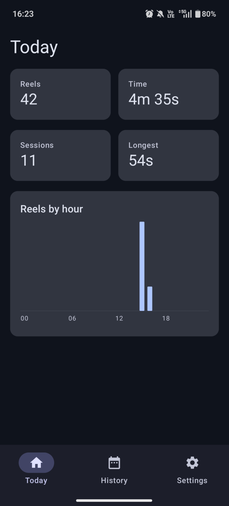
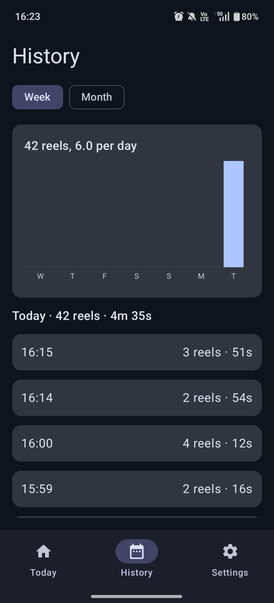
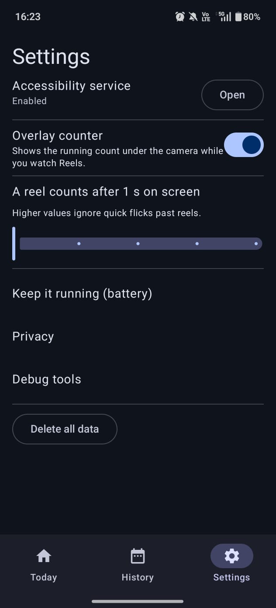

<p align="center"></p>

<h1 align="center">Reels Counter</h1>

An Android app that counts the Instagram Reels you watch and how long you spend on them. Everything stays on
the phone: the app has no internet permission and no account.

> Sideload/personal build. It relies on Instagram's internal view IDs, which Instagram can change at any time
> (see [When Instagram changes](#when-instagram-changes)).

## Screenshots

<table>
  <tr>
    <td align="center"><br><sub>Today</sub></td>
    <td align="center"><br><sub>History</sub></td>
    <td align="center"><br><sub>Settings</sub></td>
  </tr>
  <tr>
    <td align="center"><br><sub>Overlay while watching</sub></td>
    <td align="center"><br><sub>Overlay on the next reel</sub></td>
    <td></td>
  </tr>
</table>

## Features

- **Live overlay pill** under the camera cutout while you watch: `12 reels · 03:41`. It ignores touches.
- **Today:** reels, time, sessions, longest session, and a reels-by-hour chart.
- **History:** week or month chart of reels per day; tap a day to see its sessions.
- **Settings:** overlay on/off, how long a reel must stay on screen to count (1 to 5 s), delete all data.
- **Onboarding** with service status, and battery guidance for Xiaomi, Oppo/Realme/OnePlus, Vivo, Samsung and
  Huawei/Honor, since those phones kill background services.
- **Debug tools** for capturing the structure of Instagram's screens (never on-screen text).

## How it works

```
Instagram window events ──▶ detector (node tree → Signals) ──▶ single consumer loop
                                                                  │
          overlay pill ◀── live state ◀── SessionTracker (pure rules) ──▶ ReelsRepository ──▶ Room
```

- An **accessibility service** receives window events. When Instagram's Reels pager is on screen, the detector
  reports Reels as visible and gives the current reel an in-memory fingerprint.
- The **session tracker** (plain Kotlin, no Android imports) turns that into counts:
  - a reel counts after the threshold (default 1 s) on screen;
  - scrolling back to an earlier reel counts again;
  - a session ends when you open another tab, leave Instagram, or after 30 s with no activity;
  - sheets such as comments don't end a session (held for up to 2 minutes).
- Results are saved to a local **Room** database. A heartbeat every 5 s lets the app close sessions left open by
  a crash or a killed service.
- "Today" and the charts use local-time days, including 23/25-hour daylight-saving days. A session belongs to
  the day it started in.

## Permissions

The manifest requests **no permissions**. In particular, no `INTERNET`: the build fails if it ever appears in
the merged manifest.

You grant one thing by hand: **enabling the accessibility service** in Settings → Accessibility. On Android 13
and later, sideloaded apps also need "Allow restricted settings" (app info → ⋮ menu) before the switch works.
The overlay uses the accessibility overlay window type, so "draw over other apps" is not needed.

## Privacy and data

**Read** (only while the service is on): in Instagram windows, view IDs, class names, bounds, flags and content
descriptions. Descriptions are used only to recognise a reel; the text is discarded and reduced to a 32-bit
fingerprint that stays in memory (it appears in debug-log lines, never in the database). For other apps, only
the package name of a window change, to end a session when you leave Instagram.

**Stored** (app-private, not backed up, removed on uninstall):

| Where | What |
|---|---|
| Room `reels.db`, table `reel_session` | `start_ts`, `end_ts`, `reel_count` |
| Room `reels.db`, table `reel_view` | `session_id`, `ts`, `duration_ms` per counted reel |
| SharedPreferences `heartbeat` | last activity time |
| SharedPreferences `settings` | overlay on/off, reel threshold, onboarding done |

**Never stored or logged:** usernames, captions, comments, messages, or any on-screen text. Debug logging, when
on, shows a banner and writes structure only; those lines also reach Android's system log until it rotates them.

## Requirements

- JDK 21
- Android SDK with platform 37 (`sdk.dir` set in `local.properties`)
- Android 8.0 (API 26) or newer on the phone

## Build, install, test

```sh
./gradlew assembleDebug        # APK: app/build/outputs/apk/debug/app-debug.apk
./gradlew installDebug         # install on a connected device (USB debugging on)
./gradlew testDebugUnitTest    # JVM unit tests (Robolectric, no device needed)
```

After installing: open the app, follow the onboarding to enable the accessibility service, then watch some
reels. A release (minified) build has not been tested.

## Project layout

Source is under `app/src/main/java/com/mindware/reels/`:

```
detection/  InstagramConfig (all Instagram-specific strings), InstagramReelsDetector,
            ReelsAccessibilityService, NodeDump, DebugLog, ServiceStatus
session/    SessionTracker, SessionConfig, Signals, SessionAction, LiveState   (no Android imports)
data/       ReelsRepository, SettingsStore, HeartbeatStore, AppContainer, db/ (Room)
overlay/    OverlayController
stats/      local-day and hourly helpers
ui/         nav, today, history, settings, onboarding, privacy, debug, components, theme
```

Dependency injection is manual (`AppContainer`); there is no Hilt.

## When Instagram changes

If counting stops or misfires after an Instagram update, patch `detection/InstagramConfig.kt`; it holds every
Instagram-specific string. To see the new layout:

1. In the app: Settings → Debug tools → turn on **Debug logging** and **Dump node tree on change**.
2. Use Reels, then run `adb logcat -d -s ReelsDebug > log.txt`.
3. Look for the view ID of the Reels pager that is visible on a Reel and hidden or zero-width elsewhere, and
   update `reelsViewerIdHints`.

Each log line shows whether Reels was detected, the reel fingerprint, which viewer ID matched, and whether the
bottom tab bar was visible (`tabs=`).

## Known limits

- Two consecutive reels by the same author may be counted as one (the fingerprint comes from a description that
  names the author). Not yet observed either way.
- Verified by hand on one phone and one Instagram version. Detection can't be tested without a device.
- Phone makers may stop the service or switch it off after an update; the Today screen warns when it is off.
- Accessibility apps that read other apps face strict Play Store review; this project is not aimed at the store.

`PLAN.md` holds the original plan and milestones (M0 to M6, all done).
